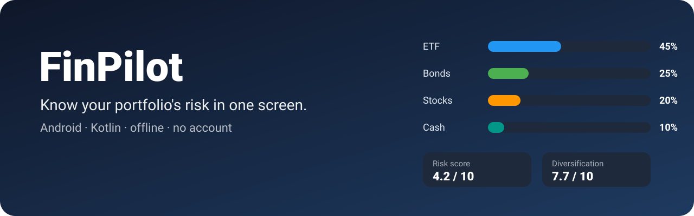
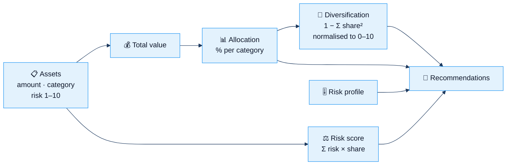

<div align="center">



# FinPilot: is my portfolio too risky?

**Add your assets, pick a risk profile, and get allocation, a risk score, a diversification score and plain-language advice. On the phone, no account, no network.**

<p align="center">
  
  
  
  
  
</p>

</div>

---

## 💼 What it is

Most people know *what* they own but not *how risky* the mix is. FinPilot takes the list of your assets and your
risk profile and tells you, in one screen, where the money sits, how concentrated it is and what to look at first.

| | |
| --- | --- |
| **Assets** | Name, category, amount and a risk level from 1 to 10 |
| **Categories** | Stocks, ETF, Bonds, Crypto, Cash, Real Estate, Gold, Commodities, Other |
| **Risk profile** | Conservative, Balanced or Aggressive |
| **Analysis** | Total value, allocation chart, risk score, diversification score, recommendations |
| **Privacy** | Everything stays in the app's private storage; no account, no network |

## ✨ Features

- **📋 Portfolio**: add assets, see the list and the total value.
- **📊 Allocation chart**: a custom Canvas view draws each category's share as a bar.
- **⚖️ Risk score**: every asset's risk level weighted by its share of the portfolio (0–10).
- **🧩 Diversification score**: how evenly the money is spread across categories (0–10).
- **💬 Recommendations**: short, readable hints tuned to your risk profile.
- **📳 Sensors on the analysis screen**: shake to refresh the analysis; the light sensor switches between "Day review" and "Night analysis" mode.

## 🧮 How the analysis works



`PortfolioAnalyzer` (in `domain/`) is a pure Kotlin object, so all of the maths is independent of the UI.

| Rule | Recommendation |
| --- | --- |
| One category above 60% | Portfolio is concentrated in that category |
| Crypto above 20% and profile not Aggressive | Crypto allocation is high for your profile |
| Cash below 5% | Cash reserve is low for short-term safety |
| ETF below 20% | Diversification could be improved with ETFs |
| Diversification score below 5 | Diversification is weak |
| Conservative and risk score above 5 | Portfolio looks too risky for a conservative profile |
| Balanced | Says whether the risk score is inside the 4–7 band |

## 📱 Screens

| Screen | What it does |
| --- | --- |
| `MainActivity` | Home and navigation |
| `PortfolioActivity` | Asset list and total value |
| `AddAssetActivity` | New asset: name, category, amount, risk slider |
| `RiskProfileActivity` | Conservative, Balanced or Aggressive |
| `AnalysisActivity` | Chart, scores, recommendations, sensors |

## 🏗️ How it's built

```
app/src/main/java/com/astmirzhan/finpilot/
├── *Activity.kt   five screens
├── model/         Asset, AssetCategory, RiskProfile
├── data/          PortfolioRepository (SharedPreferences + JSON)
├── domain/        PortfolioAnalyzer
├── ui/            AssetAdapter (RecyclerView)
└── view/          PortfolioChartView (custom Canvas view)
```

- **Kotlin**, Android Views, Material Components, `minSdk` 24, `targetSdk` 36.
- **Storage**: assets and the risk profile are saved as JSON in private `SharedPreferences`.
- A UI redesign with bottom navigation lives on the `ui-navigation-redesign` branch.

## 🛠️ Run it

Open the project in **Android Studio** and run the `app` configuration, or:

```bash
./gradlew assembleDebug
```

> ⚠️ University project and learning exercise. The recommendations are simple rules, not financial advice.

<div align="center">

**FinPilot** · MIT · know the mix before the market does 📈

</div>
